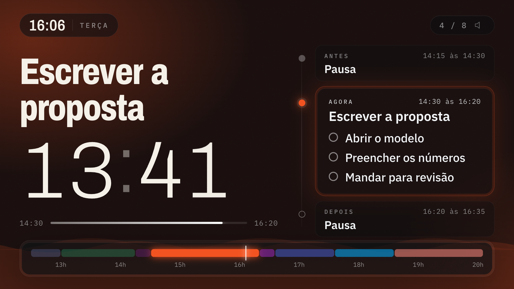

# Painel de Tempo

Uma tela para a TV (ou um monitor) que mostra o compromisso de **agora** da sua Google Agenda, em letra grande, com a contagem regressiva até ele acabar.



- **Agora:** o nome do compromisso, quanto tempo falta e as tarefas dele.
- **Antes e Depois:** o que acabou de passar (apagado) e o que vem a seguir.
- **Linha do dia:** todos os compromissos de hoje, com um marcador na hora atual.
- **Alerta:** nos últimos 10 minutos a tela vai ficando vermelha. Nos 2 últimos, fica vermelha de vez.
- **Cores:** cada compromisso aparece na cor que você escolheu no Google Agenda.
- **Tarefas:** as linhas da descrição do evento que começam com `-` viram a lista do bloco.

**Ver funcionando (com uma agenda de exemplo):** https://mottihomero-rgb.github.io/painel-de-tempo/?demo=1

---

## Conectar a agenda

Leva uns 5 minutos e é feito uma vez só. A conexão fica na **sua** conta Google: os dados vão direto do Google para o seu navegador, sem passar por nenhum servidor nosso.

1. Abra [script.google.com](https://script.google.com) e clique em **Novo projeto**. Dê o nome de **Painel de Tempo**.
2. Apague o que estiver no arquivo `Código.gs` e cole o conteúdo de [`google/Codigo.gs`](google/Codigo.gs).
3. Vá em **Configurações do projeto** (engrenagem) e marque **Mostrar arquivo de manifesto "appsscript.json" no editor**. Volte ao **Editor**, abra o `appsscript.json` e troque tudo pelo conteúdo de [`google/appsscript.json`](google/appsscript.json). Isso faz o script pedir **só leitura** da agenda.
4. Salve (Ctrl+S ou Cmd+S). No alto, escolha a função **testar** e clique em **Executar**.
5. Vai aparecer **Autorização obrigatória**. Clique em **Revisar permissões**, escolha a sua conta, depois **Avançado** e **Acessar Painel de Tempo (não seguro)**, e **Continuar**.
   O aviso aparece porque o "app" é o seu próprio script, que não passou por revisão do Google. É normal.
6. Clique em **Implantar > Nova implantação**. O tipo já vem como **App da Web**, executando como **Eu** e com acesso para **Qualquer pessoa**. Clique em **Implantar** e copie o **URL do app da Web** (termina em `/exec`).
7. Abra o [painel](https://mottihomero-rgb.github.io/painel-de-tempo/), cole o endereço e clique em **Conectar**.

Pronto. O painel lembra o endereço naquele navegador e busca a agenda de novo a cada 2 minutos.

> O endereço `/exec` funciona como senha: quem tiver ele consegue ver os seus compromissos. Não publique.

---

## Usar na TV

- Abra o link do painel no navegador da TV, ou espelhe a tela do computador.
- Aperte **F** (ou dê dois cliques) para tela cheia. O painel tenta manter a tela acesa sozinho.
- O mouse some depois de 2 segundos parado.

**Teclas:** `F` tela cheia · `S` liga o som (bipe quando começa um compromisso e 5 minutos antes de acabar) · `C` troca a agenda conectada.

Um ponto laranja no canto de cima avisa quando o painel está há mais de 15 minutos sem conseguir ler a agenda.

## Como o painel lê a agenda

- Evento de **dia inteiro** e convite **recusado** não aparecem.
- Quando dois compromissos se encavalam, o **mais curto ganha** naquele pedaço (uma reunião de 30 minutos aparece por cima de um bloco de foco de 3 horas).
- Entre um compromisso e outro aparece **Livre**, com a contagem até o próximo. Depois do último do dia, **Fora do expediente**.

Para ler mais de uma agenda, ou mostrar só "Ocupado" no lugar dos títulos, mude o `CONFIG` no começo do `Codigo.gs`. Depois de mudar o código: **Implantar > Gerenciar implantações > lápis > Versão: Nova versão > Implantar**. O endereço continua o mesmo.

## Testar um horário

Acrescente no endereço do painel: `?t=14:05` (hora), `&data=2026-10-21` (dia) e `&vel=60` (o tempo passa 60 vezes mais rápido).

## Problemas comuns

- **A tela de conectar volta com erro:** confira se o endereço termina em `/exec` e se a implantação está com acesso para **Qualquer pessoa**.
- **Conta do Google Workspace (e-mail da empresa):** alguns administradores bloqueiam a opção "Qualquer pessoa". Peça para liberar ou use uma conta Gmail que tenha acesso à agenda.
- **Mudei o código e nada mudou:** faltou publicar uma **Nova versão** da implantação.

---

## Usar como skill do Claude Code

Este repositório também é uma skill: o Claude monta e conecta o painel com você, passo a passo.

```bash
git clone https://github.com/mottihomero-rgb/painel-de-tempo ~/.claude/skills/painel-de-tempo
```

Depois é só pedir ao Claude: "monta o painel de tempo da minha agenda".

---

Feito por [Homero Motti](https://www.instagram.com/homeromotti/). Licença MIT: use, mude e distribua à vontade.
